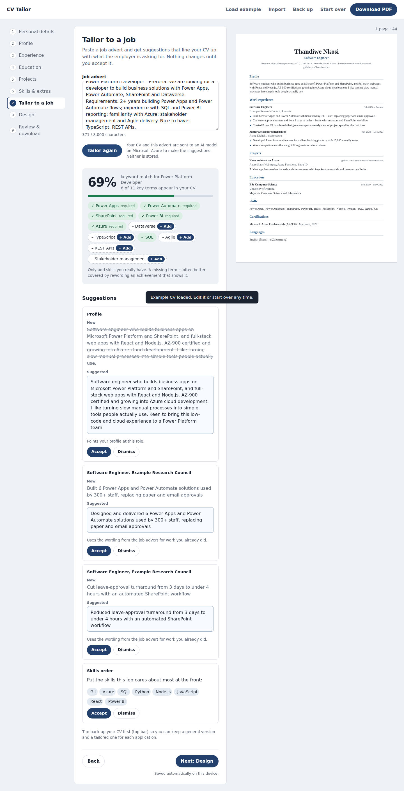
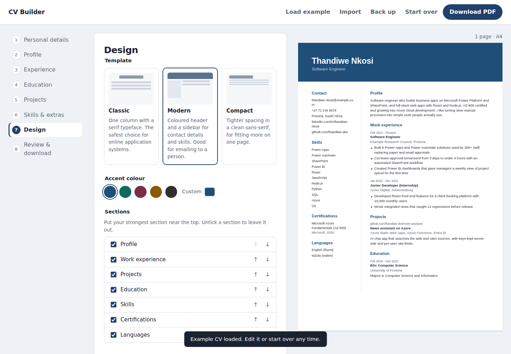
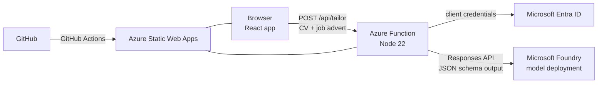

# CV Tailor

**Live site:** [CREATE](https://salmon-water-08238c11e.4.azurestaticapps.net/)

Build a CV step by step, then tailor it to a specific job: paste the advert and get a keyword match score plus suggested rewrites of your profile and achievements. You accept, edit or dismiss each suggestion, and the AI is only allowed to reword what's already in your CV.



## Features

**Tailoring (AI)**
- Keyword match score for the job, weighted towards required skills, recalculated live as you edit
- Matched and missing keywords, with one click to add a missing skill you actually have
- Suggested rewrites for your profile and achievement points, each editable before you accept it
- Skills reordered so the most relevant ones come first
- Accept all, dismiss, or undo every tailoring change in one step

**CV builder**
- Guided steps with a live preview that shows the real PDF, so what you see is exactly what downloads
- One-tap PDF download that works on phones: A4, selectable text for applicant tracking systems, no browser headers or footers
- Five templates (Classic, Executive, Modern, Minimal, Compact), accent colours, section ordering and hiding
- Optional photo, cropped and resized in the browser; it is never sent to the AI
- CV checks for weak phrasing, achievements without numbers, missing details and length
- Autosave, plus **Save file** / **Open file** to move a CV between devices or keep a version per application
- An example CV to try everything out



## Architecture



## Design decisions

| Decision | Why |
| --- | --- |
| The model only sees a compact text version of the CV, with a ref for each point (`e1.b2`) | Suggestions can be mapped back to the exact point they change |
| Structured output with a strict JSON schema | The Function gets predictable fields instead of free text |
| Server-side validation drops suggestions for points that don't exist, and skills the person didn't list | Guards against the model inventing experience |
| The match score is calculated in the browser, not by the AI | It's transparent, free, and updates instantly as you accept changes |
| A suggestion can't be applied if you've edited that point since | Prevents overwriting your newer wording |
| The CV and job advert are wrapped as data, and the prompt tells the model to ignore instructions inside them | Basic protection against prompt injection from a pasted advert |
| Service principal with one role, secrets only in app settings | Least privilege; no keys in the browser or the repo |
| Per-visitor and daily request limits, plus an Azure budget alert | Keeps model costs bounded |
| Nothing is stored server-side; the CV lives in the browser's localStorage | No database, no personal data to protect at rest |
| The PDF is built in the browser with react-pdf and the preview draws that same PDF with pdf.js | One set of templates, an exact page count, and identical output on desktop and phone |
| The PDF libraries load on demand | The editor appears fast; the large PDF code downloads in the background |
| pdf.js legacy build | The standard build needs very new JavaScript features that older phones lack |

## Tech stack

React 19 · Vite · react-pdf · pdf.js · Azure Static Web Apps · Azure Functions (Node 22) · Microsoft Foundry · Microsoft Entra ID · GitHub Actions · Node test runner

## Run locally

Requires Node 22 and [Azure Functions Core Tools](https://learn.microsoft.com/azure/azure-functions/functions-run-local) v4.

```bash
npm install
cd api && npm install && cp local.settings.example.json local.settings.json && cd ..

# terminal 1: the API (MOCK_AI=1 returns canned suggestions, no Azure needed)
cd api && func start

# terminal 2: the app, with /api proxied to port 7071
npm run dev
```

Set `MOCK_AI` to `0` and fill in the Azure values to call the real model.

Run the API tests with `cd api && npm test`.

## Deploy

1. In Microsoft Foundry, deploy a chat model to your project (a small, fast model is plenty).
2. Give a service principal the **Azure AI User** role on the project. You can reuse an existing one.
3. Create an Azure Static Web App from this repo with app location `/`, API location `api` and output location `dist`.
4. Add these environment variables to the Static Web App: `PROJECT_ENDPOINT`, `MODEL_DEPLOYMENT`, `AZ_TENANT_ID`, `AZ_CLIENT_ID`, `AZ_CLIENT_SECRET`.
5. Set a budget alert on the resource group.

## Roadmap

- [ ] Save several versions, one per application
- [ ] Cover letter generated from the CV and job advert
- [ ] Word (.docx) export
- [ ] Rate limiting backed by shared storage instead of per-instance memory
- [ ] Infrastructure as code with Bicep
